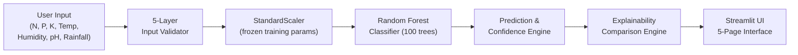

# SmartAgri AI

> **AI-Powered Crop Recommendation and Agricultural Decision Support System**

[](https://www.python.org/)
[](LICENSE)
[](https://streamlit.io/)
[](https://scikit-learn.org/)
[](tests/)

---

## 1. Project Title

**SmartAgri AI — AI-Powered Crop Recommendation and Agricultural Decision Support System**

---

## 2. Project Overview

**SmartAgri AI** is a production-grade, end-to-end machine learning platform built for agricultural decision support. It analyzes 7 soil and climate parameters to recommend the most suitable crop for a given set of agronomic conditions across 22 distinct agricultural species.

The system is built entirely in Python and provides a complete pipeline from raw data ingestion to an interactive Streamlit web interface, with embedded explainability, input validation, and responsible-use disclaimers at every layer.

---

## 3. Problem Statement

Smallholder farmers and agricultural planners frequently make crop selection decisions using informal experience, generational heuristics, or incomplete soil assessments. Planting a crop poorly matched to local nitrogen levels, rainfall patterns, or ambient temperature results in:
- Degraded soil fertility through incorrect fertilizer use
- Wasted capital investment in seed and irrigation
- Sub-optimal yields reducing food security

There is a need for an accessible, transparent, and scientifically grounded decision-support tool that integrates multivariate soil chemistry and climate data into actionable crop recommendations.

---

## 4. Motivation

Agriculture accounts for the livelihoods of more than 1 billion people globally. Even marginal improvements in crop matching — selecting crops whose growth requirements closely match local soil and climate conditions — can improve yields, reduce chemical input waste, and increase agricultural sustainability.

Machine learning classification models, when trained on verified agronomic benchmark data, can learn complex multi-dimensional relationships between soil nutrients, climate parameters, and optimal crop types that are practically impossible to codify as simple rule sets.

---

## 5. Objectives

1. **Robust Input Validation**: Enforce 5-layer agronomic boundary checks on all user inputs to prevent physically impossible predictions.
2. **Leak-Free ML Pipeline**: Implement a reproducible, data-leak-free pipeline with stratified splitting, scaler fitting exclusively on training data, and frozen preprocessing for inference.
3. **Multi-Model Benchmarking**: Empirically train and compare 5 classification algorithms on identical held-out test partitions with reported accuracy, precision, recall, F1-score, and cross-validation stability.
4. **Transparent Explainability**: Generate instance-level and global-level feature attribution using Mean Decrease in Impurity (MDI) and centroid deviation analysis — without implying causation.
5. **Production-Grade UI**: Deliver a 5-page interactive Streamlit application with presets, validation, result display, model insights, data exploration, and responsible-use disclaimers.
6. **Responsible AI**: Maintain clear distinction between statistical association and causal determination. Never fabricate metrics, dataset values, or prediction results.

---

## 6. Key Features

| Feature | Description |
| :--- | :--- |
| **7-Parameter Input Form** | Accepts Nitrogen (N), Phosphorus (P), Potassium (K), Temperature, Humidity, Soil pH, and Rainfall |
| **5-Layer Input Validation** | Rejects empty payloads, booleans, NaN/infinity, non-numeric values, and out-of-range agronomic inputs |
| **22-Crop Classification** | Predicts among 22 agricultural crops trained on a balanced 2,200-sample dataset |
| **Calibrated Confidence** | Provides probability-based confidence scores via Random Forest `predict_proba` |
| **Top-3 Alternatives** | Displays ranked runner-up crops with probabilities |
| **Global Feature Importance** | MDI-based feature importance across 100 Random Forest trees |
| **Instance-Level Explanation** | Compares user inputs against historical crop profile medians (centroid deviation) |
| **Model Comparison Dashboard** | Displays actual benchmark metrics for all 5 evaluated models |
| **Data Explorer** | Visualizes raw dataset distributions, correlations, and crop statistics |
| **Security Controls** | Path traversal prevention, safe joblib deserialization, secrets audit |
| **Comprehensive Test Suite** | 74 automated tests across 10 test modules (100% passing) |

---

## 7. System Architecture



**Full architectural specifications**: [docs/architecture.md](docs/architecture.md)

---

## 8. AI/ML Methodology

The machine learning pipeline follows a strict, reproducible 10-step lifecycle:

1. **Data Sourcing & Provenance Validation** — SHA-256 verified CC0-licensed dataset
2. **Schema Validation & Defensive Loading** — `src/data_loader.py` with `DatasetValidationError`
3. **Data Integrity Audits** — Zero missing values, zero duplicates verified
4. **Exploratory Data Analysis** — `src/eda.py` generates 8 publication-quality figures
5. **Leak-Free Preprocessing** — `src/preprocessing.py` fits scaler exclusively on $X_{\text{train}}$
6. **Multi-Model Training & Cross-Validation** — `src/train.py` with 5-fold stratified CV
7. **Empirical Evaluation** — `src/evaluate.py` on held-out test set ($N=440$)
8. **Model Selection** — Random Forest selected by Macro F1-Score + CV stability criteria
9. **Inference Service** — `src/predict.py` CropPredictor singleton with full validation
10. **Explainability** — `src/explainability.py` MDI + permutation + centroid deviation

**Full methodology**: [docs/methodology.md](docs/methodology.md)

---

## 9. Dataset

| Property | Value |
| :--- | :--- |
| **Name** | Precision Agriculture Crop Recommendation Dataset |
| **Source** | Kaggle (CC0 Public Domain) |
| **URL** | https://www.kaggle.com/datasets/atharvaingle/crop-recommendation-dataset |
| **Rows** | 2,200 |
| **Features** | 7 continuous (N, P, K, temperature, humidity, ph, rainfall) |
| **Target** | 22 balanced crop classes (100 samples each) |
| **Missing Values** | 0 |
| **Duplicate Rows** | 0 |
| **SHA-256 Checksum** | `54a5a6e5408668e668667efc50de2fc867c1b875e0431b4f54dd331b0a109a4e` |
| **License** | CC0 1.0 Universal (Public Domain Dedication) |

### Feature Summary

| Feature | Unit | Observed Min | Observed Max | Mean |
| :--- | :--- | :---: | :---: | :---: |
| `N` (Nitrogen) | kg/ha | 0.00 | 140.00 | 50.55 |
| `P` (Phosphorus) | kg/ha | 5.00 | 145.00 | 53.36 |
| `K` (Potassium) | kg/ha | 5.00 | 205.00 | 48.15 |
| `temperature` | °C | 8.83 | 43.68 | 25.62 |
| `humidity` | % | 14.26 | 99.98 | 71.48 |
| `ph` | pH | 3.50 | 9.94 | 6.47 |
| `rainfall` | mm | 20.21 | 298.56 | 103.46 |

**Full dataset documentation**: [docs/dataset.md](docs/dataset.md)

---

## 10. Preprocessing

- **Stratified 80/20 split**: 1,760 training samples (80 per class), 440 test samples (20 per class)
- **StandardScaler**: Fitted **exclusively on training data** — frozen parameters applied to test data and inference inputs to prevent data leakage
- **LabelEncoder**: Bijective integer-to-crop mapping fitted on training labels
- **Reproducibility**: All splits use `random_state=42`
- **Artifacts saved**: `models/scaler.joblib`, `models/label_encoder.joblib`

---

## 11. Exploratory Data Analysis

Eight figures generated to `reports/figures/` from the real dataset:

| Figure | Description |
| :--- | :--- |
| `crop_distribution.png` | Class balance across all 22 crops (100 per class) |
| `feature_distributions.png` | Univariate histograms for all 7 continuous features |
| `correlation_heatmap.png` | Pearson correlation matrix across 7 features |
| `npk_by_crop.png` | Nutrient profile comparison across crop types |
| `feature_importance.png` | Random Forest MDI feature importances |
| `confusion_matrix.png` | 22×22 test-set confusion matrix (Random Forest) |
| `model_comparison_bar.png` | Accuracy comparison across all 5 models |
| `climate_clustering.png` | Temperature-humidity clustering by crop type |

**Full methodology**: [docs/methodology.md](docs/methodology.md)

---

## 12. Models Tested

All 5 models were trained on identical data and evaluated on the same held-out test set ($N=440$):

| Model | Algorithm Family | Notes |
| :--- | :--- | :--- |
| **Random Forest** | Bagging Ensemble (100 trees) | **Selected for production** |
| **Support Vector Machine** | RBF Kernel Separator | Hyperplane optimization |
| **K-Nearest Neighbors** | Instance-based, $k=5$ | Distance metric voting |
| **Decision Tree** | Recursive CART Splitting | Greedy gini splitting |
| **Logistic Regression** | Multinomial Cross-Entropy | Linear decision boundaries |

---

## 13. Model Evaluation

All metrics are measured on the **real held-out test set** ($N=440$). No fabricated numbers.

| Model | Test Accuracy | Macro F1 | CV Mean (±Std) |
| :--- | :---: | :---: | :---: |
| **Random Forest** | **0.9955** | **0.9955** | **0.9932 (±0.0058)** |
| Support Vector Machine | 0.9841 | 0.9840 | 0.9795 (±0.0107) |
| K-Nearest Neighbors | 0.9818 | 0.9816 | 0.9682 (±0.0117) |
| Decision Tree | 0.9795 | 0.9794 | 0.9847 (±0.0066) |
| Logistic Regression | 0.9727 | 0.9725 | 0.9682 (±0.0066) |

**Full evaluation report**: [docs/model_evaluation.md](docs/model_evaluation.md)

---

## 14. Final Model

**Random Forest Classifier** was selected based on five documented criteria:

1. **Highest Test Accuracy**: 99.55% (438/440 correct predictions)
2. **Highest Macro F1-Score**: 0.9955 — equal performance across all 22 crops
3. **Best CV Stability**: Mean 99.32%, narrowest variance (±0.0058) across 5 folds
4. **Native Explainability**: MDI feature importances across 100 decision trees
5. **Reliable `predict_proba`**: Calibrated probability vector for confidence and alternatives

**Saved to**: `models/crop_recommender_model.joblib` (3.4 MB), `models/metadata.json`

---

## 15. Explainability

The system implements a two-tier explainability framework (no SHAP required):

**Global Attribution (Model-Level)**
| Rank | Feature | MDI Importance | Permutation Drop |
| :---: | :--- | :---: | :---: |
| 1 | `rainfall` | 23.02% | 0.1932 |
| 2 | `humidity` | 22.42% | 0.3234 |
| 3 | `K` | 17.54% | — |
| 4 | `P` | 15.08% | — |
| 5 | `N` | 9.64% | 0.2102 |
| 6 | `temperature` | 7.24% | — |
| 7 | `ph` | 5.06% | — |

**Local Attribution (Instance-Level)**
- Each prediction includes a feature comparison table showing user inputs vs historical crop profile medians
- Alignment status: `Optimal`, `Higher than typical`, or `Lower than typical`
- Wording is careful: "The model identified these features as influential" — never implying causation

**Full explainability documentation**: [docs/explainability.md](docs/explainability.md)

---

## 16. Application UI

A 5-page Streamlit application at `app/app.py`:

| Page | Content |
| :--- | :--- |
| **🏠 Home** | Project overview, problem statement, key features, AI methodology summary, responsible-use disclaimer |
| **🌱 Crop Recommendation** | 7-parameter input form, 5 agronomic presets, real-time validation, prediction result with confidence and top-3 alternatives, explainability comparison table |
| **📊 Model Insights** | Live benchmark comparison table, confusion matrix chart, feature importance chart |
| **📁 Data Explorer** | Raw dataset statistics, crop distribution, feature distributions, correlation heatmap |
| **ℹ️ About** | Project provenance, dataset licensing, methodology summary, ethical AI statement |

---

## 17. Installation

### Prerequisites
- Python 3.10 or higher (developed and tested on 3.12.3)
- macOS, Linux, or Windows
- `git` (optional, for cloning)

### Step 1 — Navigate to project directory
```bash
cd /path/to/SmartAgri-AI
```

### Step 2 — Create virtual environment
```bash
python3 -m venv .venv
```

### Step 3 — Activate virtual environment
```bash
# macOS / Linux
source .venv/bin/activate

# Windows
.venv\Scripts\activate
```

### Step 4 — Install dependencies
```bash
pip install --upgrade pip
pip install -r requirements.txt
```

---

## 18. Environment Setup

All paths are configurable via optional environment variables (see [docs/security.md](docs/security.md)):

| Variable | Default | Description |
| :--- | :--- | :--- |
| `SMARTAGRI_DATA_DIR` | `<project>/data` | Root data directory |
| `SMARTAGRI_MODELS_DIR` | `<project>/models` | Serialized model artifacts directory |
| `SMARTAGRI_RAW_DATASET_PATH` | `<data>/raw/Crop_recommendation.csv` | Explicit dataset path |
| `MPLCONFIGDIR` | `<project>/.cache/matplotlib` | Matplotlib font cache directory |

No secrets, API keys, or credentials are required.

---

## 19. Dataset Setup

Download `Crop_recommendation.csv` and place it at `data/raw/Crop_recommendation.csv`:

```bash
# Option A — Manual download from Kaggle:
# https://www.kaggle.com/datasets/atharvaingle/crop-recommendation-dataset

# Option B — Download from verified mirror:
curl -o data/raw/Crop_recommendation.csv \
  https://raw.githubusercontent.com/gabbygab1233/Crop-Recommender/master/Crop_recommendation.csv
```

Verify SHA-256 checksum:
```bash
shasum -a 256 data/raw/Crop_recommendation.csv
# Expected: 54a5a6e5408668e668667efc50de2fc867c1b875e0431b4f54dd331b0a109a4e
```

---

## 20. Training Command

Run from project root. Requires the dataset at `data/raw/Crop_recommendation.csv`.

```bash
# Step 1 — Preprocess data and generate train/test splits
.venv/bin/python -m src.preprocessing

# Step 2 — Train and cross-validate all 5 candidate models
.venv/bin/python -m src.train

# Step 3 — Evaluate all candidates and select final model
.venv/bin/python -m src.evaluate
```

---

## 21. Evaluation Command

```bash
# Re-run evaluation on held-out test set to regenerate reports
.venv/bin/python -m src.evaluate
```

Outputs saved to `reports/model_comparison.json` and `reports/figures/`.

---

## 22. Application Command

```bash
.venv/bin/streamlit run app/app.py
```

The application opens at `http://localhost:8501` in your default browser.

---

## 23. Testing Command

```bash
# Run full test suite (74 tests)
.venv/bin/pytest tests/ -v

# Quick summary run
.venv/bin/pytest tests/ -q

# Specific module
.venv/bin/pytest tests/test_prediction.py -v
```

**Full test documentation**: [docs/testing.md](docs/testing.md)

---

## 24. Project Structure

```
SmartAgri-AI/
├── .cache/                             # Runtime cache (matplotlib fonts)
├── .gitignore                          # Git exclusion rules
├── .venv/                              # Python virtual environment (not tracked)
├── LICENSE                             # MIT open-source license
├── PROJECT_STRUCTURE.md                # Detailed directory documentation
├── README.md                           # Main project documentation (this file)
├── requirements.txt                    # Pinned Python dependencies
├── pytest.ini                          # Pytest configuration
│
├── app/                                # Streamlit web application
│   ├── app.py                          # 5-page application entry point (655 lines)
│   └── assets/
│       └── style.css                   # Custom CSS — dark green enterprise theme
│
├── data/                               # Data storage
│   ├── raw/
│   │   └── Crop_recommendation.csv     # Source dataset (2,200 rows)
│   └── processed/
│       ├── train.csv                   # 1,760-row training split
│       ├── test.csv                    # 440-row held-out test split
│       └── preprocessor_meta.json      # Scaler and encoder metadata
│
├── docs/                               # Technical documentation
│   ├── architecture.md                 # System architecture & data flow diagrams
│   ├── dataset.md                      # Dataset provenance, schema, bounds
│   ├── deployment.md                   # Deployment guide (local, cloud, Docker)
│   ├── environment.md                  # Environment setup reference
│   ├── explainability.md               # Explainability framework documentation
│   ├── methodology.md                  # End-to-end ML lifecycle
│   ├── model_evaluation.md             # Benchmark comparison and selection rationale
│   ├── security.md                     # Security controls and zero-secrets audit
│   └── testing.md                      # Testing strategy and empirical results
│
├── models/                             # Serialized ML artifacts
│   ├── candidates/                     # 5 candidate model joblib files
│   ├── crop_profiles.json              # Per-crop training medians (22 crops)
│   ├── crop_recommender_model.joblib   # Production Random Forest (3.4 MB)
│   ├── label_encoder.joblib            # Target label encoder
│   ├── metadata.json                   # Model version, metrics, feature importances
│   └── scaler.joblib                   # StandardScaler (training parameters)
│
├── notebooks/
│   └── exploratory_analysis.ipynb      # Interactive EDA notebook
│
├── reports/
│   ├── classification_report.json      # Per-class precision/recall/F1 (all 22 crops)
│   ├── explainability.json             # MDI + permutation importance data
│   ├── model_comparison.json           # Benchmark metrics (5 models)
│   └── figures/                        # 8 generated PNG charts
│       ├── climate_clustering.png
│       ├── confusion_matrix.png
│       ├── correlation_heatmap.png
│       ├── crop_distribution.png
│       ├── feature_distributions.png
│       ├── feature_importance.png
│       ├── model_comparison_bar.png
│       └── npk_by_crop.png
│
├── src/                                # Modular production source code
│   ├── __init__.py
│   ├── config.py                       # Paths, bounds, ML parameters (single source of truth)
│   ├── data_loader.py                  # Ingestion, schema validation, empty-file guard
│   ├── eda.py                          # EDA figures generation
│   ├── evaluate.py                     # Multi-metric evaluation, model selection
│   ├── explainability.py               # MDI, permutation, centroid deviation engine
│   ├── predict.py                      # CropPredictor singleton, 5-layer validation
│   ├── preprocessing.py                # Leak-free split, StandardScaler pipeline
│   ├── train.py                        # 5-model training, CV, candidate serialization
│   └── utils.py                        # Logger, load_json, safe_resolve_path, safe_load_joblib
│
└── tests/                              # Automated pytest test suite (74 tests)
    ├── test_app_logic.py               # Business logic, presets, boundary inputs
    ├── test_data.py                    # Dataset loading and schema validation
    ├── test_environment.py             # Python version and package imports
    ├── test_explainability.py          # MDI sums, narrative generation
    ├── test_model.py                   # Model loading, metrics, metadata
    ├── test_prediction.py              # Prediction pipeline, output schema
    ├── test_preprocessing.py           # Split shapes, leakage, standardization
    ├── test_security_and_reliability.py # Path traversal, corruption, secrets
    ├── test_ui.py                      # Streamlit file integrity, CSS, figures
    └── test_validation.py              # 5-layer validation rejection tests
```

---

## 25. Screenshots

> Screenshots are generated from the running Streamlit application at `http://localhost:8501`.

| Page | Description |
| :--- | :--- |
| **Home** | SmartAgri AI branding, overview cards, feature highlights |
| **Crop Recommendation** | 7-parameter input form with preset buttons and real-time validation |
| **Prediction Result** | Recommended crop card, confidence badge, top-3 alternatives with progress bars |
| **Explainability Table** | Feature comparison: user input vs crop ideal median, alignment status |
| **Model Insights** | Live benchmark comparison table with all 5 models and key metrics |
| **Data Explorer** | Crop distribution, feature histograms, and correlation heatmap |

To launch and capture screenshots:
```bash
.venv/bin/streamlit run app/app.py
```

---

## 26. Known Limitations

1. **Training Dataset Scope**: The model is trained on a controlled benchmark dataset of 2,200 samples representing idealized agronomic conditions. Real-world soil samples may include confounding variables not captured in this dataset (heavy metals, micronutrient deficiencies, drainage class).
2. **Static Model**: The deployed Random Forest classifier does not continuously learn from new predictions. Periodic retraining on expanded agronomic datasets would improve generalization.
3. **Geographic Generalizability**: The dataset does not encode geographic origin. Predictions assume that soil nutrient and climate inputs are representative of a general tropical/subtropical agricultural context.
4. **No Time-Series**: Seasonal dynamics, planting calendars, pest pressure cycles, and crop rotation effects are not modeled.
5. **22 Fixed Crop Classes**: The model can only recommend from the 22 crops present in the training dataset. Crops outside this set cannot be predicted.
6. **UI Testing Limitation**: Streamlit UI tests verify static file integrity and asset presence. End-to-end browser automation is not included in the standard test suite.

---

## 27. Responsible AI Statement

> [!IMPORTANT]
> **SmartAgri AI is a Decision-Support Tool — Not Agricultural Advice**
>
> This system generates crop recommendations using a statistical machine learning model trained on historical benchmark data. It does not constitute professional agricultural advice, guaranteed crop yield, disease prevention, or economic return on investment.
>
> **Prohibited interpretation**: *"This model guarantees that growing rice will be profitable."*
>
> **Approved interpretation**: *"The model identified rainfall, humidity, and potassium as key factors associated with recommending rice under these input conditions."*
>
> Consult a certified local agronomist or agricultural extension officer before making capital investment decisions.

---

## 28. Ethical Considerations

1. **No Causation Claims**: Feature importance rankings reflect learned statistical associations, not proven causal mechanisms. The system's phrasing is deliberately conservative and associative.
2. **Transparency**: All model selection decisions, evaluation metrics, and limitations are documented in `docs/model_evaluation.md`. No metric is fabricated or inflated.
3. **Data Provenance**: The dataset is publicly licensed under CC0 1.0. No proprietary, personal, or private agricultural data is collected or stored.
4. **Zero User Data Collection**: The application collects no personal information, usage telemetry, or location data.
5. **Access Equity**: The tool is designed for accessibility without requiring user accounts, subscriptions, or authentication.
6. **Model Bias Awareness**: The balanced 22-class dataset treats all crops equally. However, the training data may not represent the full diversity of global agricultural ecosystems.

---

## 29. Future Scope

| Enhancement | Description |
| :--- | :--- |
| **Expanded Dataset** | Incorporate real-world GPS-tagged soil test data from agricultural research institutes |
| **Time-Series Modeling** | Add seasonal planting calendar recommendations using temporal climate data |
| **Geospatial Integration** | Map-based input via GPS coordinates to auto-populate climate parameters from regional weather APIs |
| **Continuous Learning** | Allow optional feedback from agronomists to fine-tune model weights on verified outcome data |
| **Mobile Application** | Port the Streamlit interface to a React Native or Flutter mobile app for offline field use |
| **Multi-Language Support** | Localize the interface to regional agricultural languages (Hindi, Swahili, Indonesian) |
| **SHAP Integration** | Supplement MDI with SHAP values for more granular per-prediction feature attributions |
| **REST API** | Expose the prediction service as a Flask/FastAPI REST endpoint for third-party integrations |

---

## 30. Deployment

See [docs/deployment.md](docs/deployment.md) for the complete deployment guide covering:
- Local development server
- Streamlit Community Cloud deployment
- Docker containerization

---

## 31. License

This project is licensed under the **MIT License**. See [LICENSE](LICENSE) for the full license text.

The dataset (`Crop_recommendation.csv`) is licensed under **Creative Commons Public Domain Dedication (CC0 1.0 Universal)** and may be used freely for research, education, and development.

---

## 32. Technology Stack

| Component | Library / Tool | Version Constraint |
| :--- | :--- | :--- |
| Language | Python | `>=3.10` |
| Data Manipulation | pandas | `>=2.2.0, <3.0.0` |
| Numerical Computing | numpy | `>=1.26.0, <2.0.0` |
| Machine Learning | scikit-learn | `>=1.4.0, <1.6.0` |
| Model Serialization | joblib | `>=1.3.0, <1.5.0` |
| Visualization | matplotlib | `>=3.8.0, <4.0.0` |
| Visualization | seaborn | `>=0.13.0, <0.14.0` |
| Web Application | streamlit | `>=1.32.0, <2.0.0` |
| Testing | pytest | `>=8.0.0, <9.0.0` |
