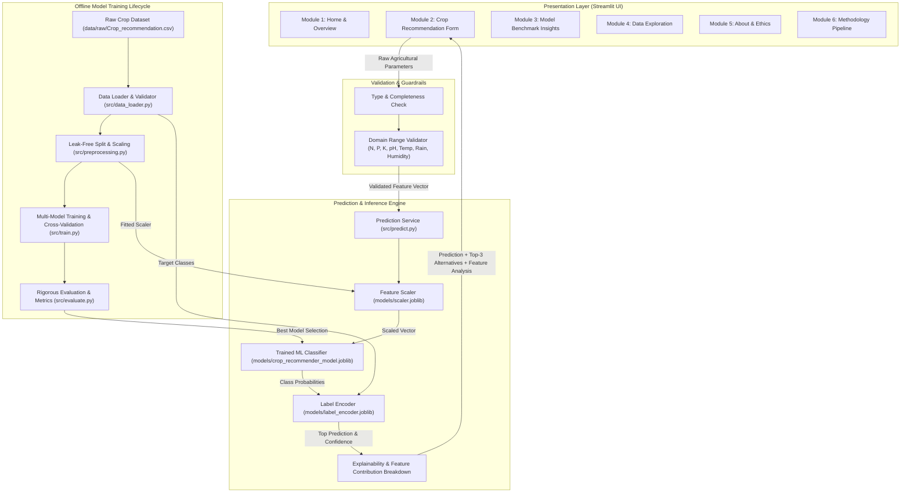

# SmartAgri-AI: System Architecture

## 1. System Overview

**SmartAgri-AI** is designed as a modular, decoupled, production-grade AI decision-support system. It bridges agronomic data science with an interactive, user-centered decision interface to recommend optimal crops based on soil nutrient ratios and environmental parameters.

The architecture enforces strict separation between:
1. **Offline Training & Preprocessing Pipeline**: Deterministic, reproducible, leak-free machine learning workflow.
2. **Online Inference & Validation Service**: Low-latency, stateless prediction service with strict domain boundary checks.
3. **Interactive Presentation Layer**: Responsive multi-module web interface with explainability visualizations and ethical disclaimers.

---

## 2. High-Level Architecture Diagram



---

## 3. ASCII Architecture Topology (Fallback)

```
[ User Input (Browser) ]
         │
         ▼
[ Module 2: Streamlit Prediction Form ]
         │
         ▼
[ Input Validation Layer ]
   ├── Non-null & Type Checking
   └── Agronomic Domain Bounds Verification
         │
         ▼
[ Prediction Service (src/predict.py) ]
   ├── Load Preprocessing Scaler (Fitted on Train Set)
   ├── Transform Feature Vector [N, P, K, Temp, Humidity, pH, Rainfall]
   └── Query Classifier (Random Forest / Best Evaluated Model)
         │
         ├──────────────────────────────┐
         ▼                              ▼
[ Top Class Probabilities ]     [ Feature Influence Analysis ]
         │                              │
         └──────────────┬───────────────┘
                        ▼
         [ Result Presentation Card ]
            ├── Recommended Crop Name
            ├── Model Confidence Indicator
            ├── Top-3 Alternative Recommendations
            ├── Agronomic Comparison (User vs Crop Medians)
            └── Responsible AI Disclaimer
```

---

## 4. Layer Responsibilities

### 4.1 Presentation Layer (`app/`)
- Built with **Streamlit** for clean, responsive interactions.
- Divided into 5 cohesive pages:
  - **Home** (`🏠`): High-level overview, problem context, key features, AI methodology summary, and ethical disclaimer.
  - **Crop Recommendation** (`🌱`): 7-parameter input form with agronomic presets, real-time validation, prediction display with confidence, top-3 alternatives, and explainability comparison table.
  - **Model Insights** (`📊`): Live benchmark comparison table and charts (accuracy, precision, recall, F1-score, confusion matrix, feature importance).
  - **Data Explorer** (`📁`): Visual distributions of agricultural attributes, crop balance, and correlation heatmap.
  - **About** (`ℹ️`): Project provenance, dataset licensing, technology stack, and ethical AI statement.

### 4.2 Validation Layer (`src/preprocessing.py` & `src/predict.py`)
- Rejects missing values, non-numeric strings, and out-of-bounds inputs.
- Evaluates domain ranges established from agronomic benchmarks:
  - Nitrogen: $0 \le N \le 140\text{ kg/ha}$
  - Phosphorus: $5 \le P \le 145\text{ kg/ha}$
  - Potassium: $5 \le K \le 205\text{ kg/ha}$
  - Temperature: $8.0 \le \text{Temp} \le 45.0^\circ\text{C}$
  - Humidity: $10.0\% \le \text{Humidity} \le 100.0\%$
  - Soil pH: $3.5 \le \text{pH} \le 10.0$
  - Rainfall: $20.0 \le \text{Rainfall} \le 300.0\text{ mm}$

### 4.3 Preprocessing & Leak Prevention Layer (`src/preprocessing.py`)
- Enforces strict leak-prevention: Feature transformers (e.g. `StandardScaler`) are fitted **only** on the training split ($X_{train}$) and transformed onto $X_{test}$ and incoming live queries.
- Preserves class proportions using stratified train-test splitting (`test_size=0.20`, `stratify=y`, `random_state=42`).

### 4.4 Machine Learning Engine (`src/train.py`, `src/evaluate.py`)
- Evaluates 5 diverse classification families:
  1. Random Forest (Ensemble bagging)
  2. Decision Tree (Single decision tree)
  3. Logistic Regression (Linear multinomial)
  4. Support Vector Machine (Kernel separation)
  5. K-Nearest Neighbors (Instance-based clustering)
- Selection criteria balances F1-score (Macro and Weighted), accuracy, and inference latency.

### 4.5 Explainability Layer (`src/predict.py`)
- Generates transparent, human-interpretable explanations.
- Highlights feature deviation from crop-specific centroid medians in the training corpus.
- Emphasizes that feature correlations represent model associations rather than biological guarantees.

---

## 5. Security & Reliability Principles

1. **No External Secrets**: Fully self-contained local model deployment without requiring third-party API keys or unencrypted tokens.
2. **Safe Deserialization**: Machine learning artifacts are loaded strictly from the verified local `models/` directory.
3. **Graceful Degradation**: Clear user-facing error messages if dataset files, scalers, or model artifacts are missing.
4. **Non-Blocking Operation**: Lightweight memory footprint and sub-100ms inference times.
