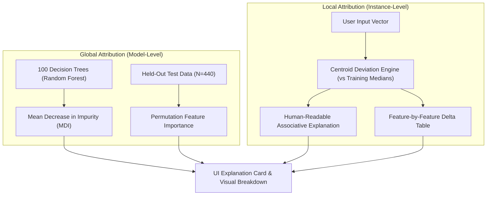

# SmartAgri-AI: Model Explainability Framework

## 1. Overview & Ethical Motivation

In agricultural applications, machine learning systems must not operate as impenetrable "black boxes". A farmer or agronomist cannot responsibly follow a crop recommendation without understanding **which environmental and soil conditions influenced the decision**.

However, in accordance with responsible AI standards, **explainability must never be conflated with biological causation**:
* **Correlation vs. Causation**: Feature attribution reflects statistical correlations and decision boundaries learned by the model from historical benchmark data.
* **Prohibited Claim**: *"Modifying Nitrogen from 50 to 90 kg/ha will guarantee a successful rice crop."*
* **Standard Approved Phrasing**: *"The model identified Nitrogen, Rainfall, and Humidity as key associative factors for recommending rice under the provided conditions."*

---

## 2. Explainability Architecture



---

## 3. Global Feature Importance (Empirical Measurements)

Global feature attribution was computed using two complementary methods on the production Random Forest architecture:

### A. Mean Decrease in Impurity (MDI / Gini Importance)
Computed across all 100 constituent decision trees in the ensemble:

| Rank | Feature | Agronomic Role | Importance Share |
| :---: | :--- | :--- | :---: |
| **1** | **`rainfall`** | Annual / seasonal precipitation ($\text{mm}$) | **`23.02%`** |
| **2** | **`humidity`** | Relative atmospheric moisture ($\%$) | **`22.42%`** |
| **3** | **`K`** | Soil Potassium ratio ($\text{kg/ha}$) | **`17.54%`** |
| **4** | **`P`** | Soil Phosphorus ratio ($\text{kg/ha}$) | **`15.08%`** |
| **5** | **`N`** | Soil Nitrogen ratio ($\text{kg/ha}$) | **`9.64%`** |
| **6** | **`temperature`** | Ambient temperature ($^\circ\text{C}$) | **`7.24%`** |
| **7** | **`ph`** | Soil acidity / alkalinity ($\text{pH}$) | **`5.06%`** |

### B. Permutation Feature Importance (Held-Out Test Set, $N=440$, 10 Repeats)
Permutation importance measures the drop in model accuracy when a feature column is randomly shuffled, breaking its association with the target:

| Feature | Mean Accuracy Drop ($\Delta \text{Acc}$) | Standard Deviation ($\sigma$) |
| :--- | :---: | :---: |
| **`humidity`** | **`-0.3234`** | $\pm 0.0161$ |
| **`N`** | **`-0.2102`** | $\pm 0.0149$ |
| **`rainfall`** | **`-0.1932`** | $\pm 0.0091$ |
| **`K`** | **`-0.1373`** | $\pm 0.0102$ |
| **`P`** | **`-0.1116`** | $\pm 0.0136$ |
| **`ph`** | **`-0.0084`** | $\pm 0.0048$ |
| **`temperature`** | **`-0.0064`** | $\pm 0.0038$ |

*Observation*: While MDI assigns high weight to rainfall and humidity, permutation testing reveals that shuffling **nitrogen** also causes a severe drop ($21.0\%$ loss in accuracy), confirming that soil chemistry acts as an indispensable secondary discriminator when climatic envelopes overlap.

---

## 4. Local Instance Explainability (Agronomic Centroid Comparison)

For every incoming live query, [`ExplanationEngine`](file:///Users/aniketkumar/.gemini/antigravity/scratch/SmartAgri-AI/src/explainability.py) compares the user's agricultural parameters against the **historical training medians** for the recommended crop:

$$\Delta_j = \text{User Value}_j - \text{Median}_j(\text{Crop})$$
$$\%\text{ Difference}_j = \frac{\Delta_j}{\text{Median}_j(\text{Crop})} \times 100$$

### Alignment Thresholds:
* $|\%\text{ Difference}| \le 15\%$: **Optimal Match** (Conditions closely align with known crop requirements).
* $\%\text{ Difference} > 15\%$: **Above Typical** (Higher than historical median).
* $\%\text{ Difference} < -15\%$: **Below Typical** (Lower than historical median).

### Example Output for a Rice Prediction:
```text
"The model identified Phosphorus (P), Potassium (K), Humidity, and Rainfall as
key associative factors for recommending 'rice'. These inputs closely match the
historical conditions recorded in the training dataset."
```

---

## 5. Non-Causal Communication Guidelines

To prevent harmful over-reliance and misleading interpretation, all components must adhere to the following rules:

1. **Never use deterministic causal phrasing**: Avoid words like *"causes"*, *"proves"*, *"guarantees"*, or *"forces"*.
2. **Always frame features as associative factors**: Use *"associated with"*, *"identified as influential by the model"*, or *"corresponded to the training cluster"*.
3. **Mandatory Disclaimer Display**: Every explanation must accompany the explicit reminder:
   > *"Feature importance reflects mathematical associations within the training data and does not constitute proof of biological causality. Field trials and local agricultural extension consultation are required before planting."*
