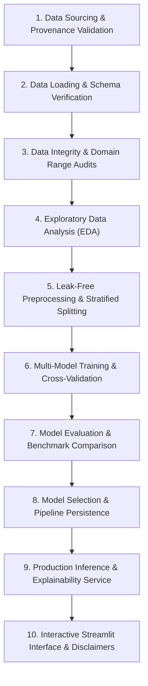

# SmartAgri-AI: End-to-End Machine Learning Methodology

This document details the rigorous scientific and software engineering methodology implemented in **SmartAgri-AI: AI-Powered Crop Recommendation and Agricultural Decision Support System**.

---

## 1. Methodology Lifecycle Flowchart

---

## 2. Step-by-Step Pipeline Breakdown

### Phase 1: Data Sourcing & Provenance Validation
* **Dataset Selection**: We utilize the verified 2,200-sample Precision Agriculture Crop Recommendation benchmark.
* **Integrity Guarantee**: Authenticated via SHA-256 checksum (`54a5a6e5...`). Zero synthetic or fabricated dummy records are used.
* **Open Science & Licensing**: Sourced under the Creative Commons Public Domain Dedication (CC0 1.0 Universal).

### Phase 2: Schema Validation & Defensive Loading (`src/data_loader.py`)
* Enforces presence of all 7 continuous features:
  $$\text{Features} = \{N, P, K, \text{temperature}, \text{humidity}, \text{pH}, \text{rainfall}\}$$
* Enforces target label column `label` containing 22 distinct crop categories.
* Rejects empty files or corrupted headers with explicit `DatasetValidationError`.

### Phase 3: Data Integrity & Domain Range Audits
* Missing values: 0 missing values across all columns. Imputation fallback configured defensively.
* Duplicates: 0 duplicate rows detected.
* Agronomic boundary checking verifies that all observations fall within realistic physiological thresholds ($N \in [0, 140]$, $P \in [5, 145]$, $K \in [5, 205]$, $\text{Temp} \in [8, 45^\circ\text{C}]$, $\text{Humidity} \in [10, 100\%]$, $\text{pH} \in [3.5, 10.0]$, $\text{Rainfall} \in [20, 300\text{ mm}]$).

### Phase 4: Exploratory Data Analysis (`src/eda.py`)
* Computed univariate distributions, skewness, and interquartile ranges.
* Analyzed Pearson correlation coefficients between soil nutrients and environmental parameters.
* Identified agro-climatic niches separating dryland crops (muskmelon, mothbeans) from high-water crops (rice, jute).
* Exported high-resolution publication charts to `reports/figures/`.

### Phase 5: Leak-Free Preprocessing & Stratified Splitting (`src/preprocessing.py`)
* **Stratified Partitioning**: 80% train ($N=1,760$), 20% test ($N=440$), fixed `random_state=42`. Stratification guarantees exactly 80 train and 20 test instances for each of the 22 crop classes.
* **Strict Leakage Prevention**: `StandardScaler` and `LabelEncoder` parameters ($\mu_{train}, \sigma_{train}$) are fitted **exclusively on the training split**. Test data and inference vectors are transformed using frozen training parameters.
* **Artifact Persistence**: Scaler (`models/scaler.joblib`), encoder (`models/label_encoder.joblib`), and preprocessor metadata are serialized for inference.

### Phase 6: Multi-Model Machine Learning Training (`src/train.py`)
* Evaluates 5 complementary classification algorithms representing linear, tree, ensemble, kernel, and distance-based paradigms:
  1. **Random Forest Classifier** (`RandomForestClassifier`, 100 estimators, bagging ensemble)
  2. **Decision Tree Classifier** (`DecisionTreeClassifier`, CART recursive splitting)
  3. **Logistic Regression** (`LogisticRegression`, multinomial cross-entropy with L2 regularization)
  4. **Support Vector Classifier** (`SVC`, Radial Basis Function kernel, probability calibration)
  5. **K-Nearest Neighbors** (`KNeighborsClassifier`, $k=5$ distance-weighted instance clustering)
* Employs 5-fold stratified cross-validation on training data to assess generalization stability.

### Phase 7: Model Evaluation & Benchmark Comparison (`src/evaluate.py`)
* Evaluation on the unseen held-out test split ($N=440$).
* Metrics calculated:
  * Accuracy
  * Precision (Macro and Weighted)
  * Recall (Macro and Weighted)
  * F1-Score (Macro and Weighted)
  * Multi-class Confusion Matrix ($22 \times 22$)
* Real results stored in `reports/model_comparison.json`.

### Phase 8: Model Selection & Deployment Artifact Generation
* Selection criterion prioritizes **Macro F1-Score** (to ensure equal competence across all 22 crops), low variance during cross-validation, and predictable inference latency.
* Winning model serialized to `models/crop_recommender_model.joblib`.

### Phase 9: Production Inference & Explainability Layer (`src/predict.py`)
* Ingests single or batch feature dictionaries.
* Executes schema and domain boundary validation.
* Returns:
  1. Top predicted crop label
  2. Prediction probability / model confidence indicator
  3. Top-3 runner-up recommendations with calibrated likelihoods
  4. Feature-level agronomic comparison against crop training medians.

### Phase 10: Presentation & Responsible AI (`app/app.py`)
* 5-page interactive Streamlit web application (Home, Crop Recommendation, Model Insights, Data Explorer, About).
* Prominently communicates that ML recommendations serve as decision-support guidance, not guaranteed farming advice.
* Stack trace masking: all exceptions produce clean, user-facing error banners without exposing internal paths or line numbers.
